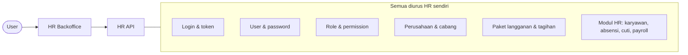
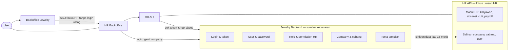
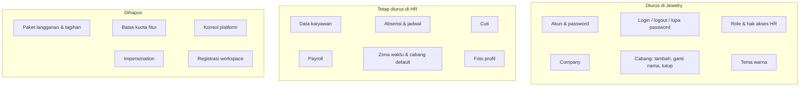
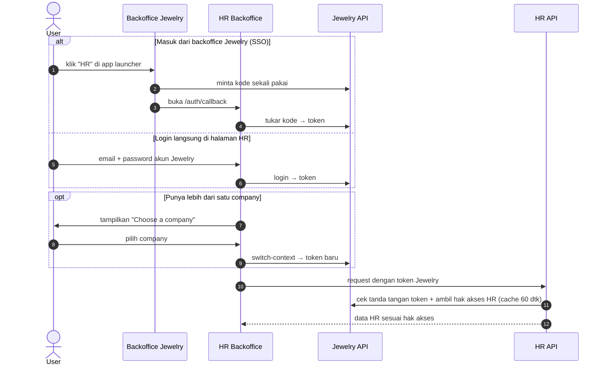
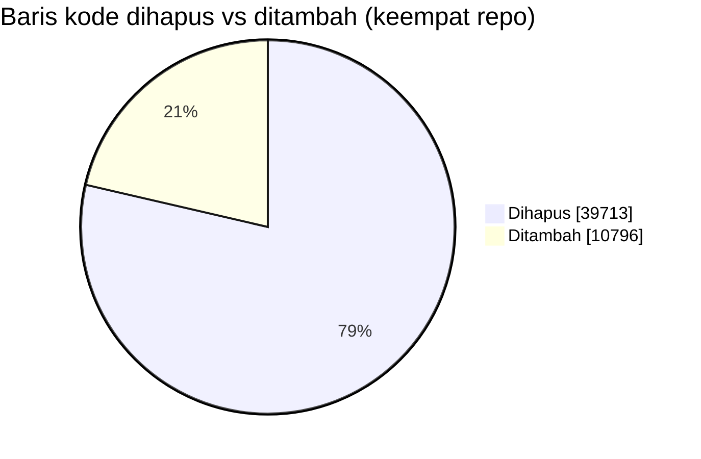

<!-- 📁 integrations/jewelry/00-ringkasan-perubahan.md -->
# Ringkasan Perubahan: `main` → cabang integrasi Jewelry

> **Satu kalimat:** di cabang ini, HR berhenti mengurus **akun, login, role, perusahaan, cabang, dan langganan** sendiri. Semua itu sekarang diurus **Jewelry**; HR fokus pada urusan HR-nya (karyawan, absensi, cuti, payroll).

| Repo | Cabang | Dibandingkan dengan |
|---|---|---|
| HR-SYSTEM-API | `jewerly-integration` | `main` |
| HR-SYSTEM-BACKOFFICE | `jewerly-integration` | `main` |
| jewelry-be | `hr-system` | titik cabang sebelum Fase 1 |
| jewelry-fe | `hr-system` | titik cabang sebelum Fase 9 |

---

## 1. Gambaran besar: sebelum vs sesudah

### Sebelum (`main`) — HR berdiri sendiri

### Sesudah (cabang integrasi) — Jewelry jadi pusat identitas

---

## 2. Siapa memegang apa

| Hal | Di `main` | Di cabang integrasi |
|---|---|---|
| Daftar akun & login | Halaman login HR, akun HR | **Akun Jewelry** — bisa login di halaman HR atau masuk dari backoffice Jewelry |
| Lupa / ganti password | Di HR | Di Jewelry (HR hanya menautkan) |
| Role & hak akses | Halaman *Users* & *Roles* di HR | Diatur di **backoffice Jewelry**, tab aplikasi HR |
| Perusahaan (tenant) | Dibuat lewat provisioning HR | **Company Jewelry = tenant HR**, otomatis tersedia |
| Cabang | Tambah/ubah/tutup di HR | Dikelola di Jewelry; HR hanya atur **zona waktu** & **cabang default** |
| Langganan & fitur | Ada paket, kuota, tagihan | **Tidak ada** — semua company dapat semua fitur HR |
| Data awal company baru | Saat provisioning | Otomatis saat company pertama dibuka di HR |
| Tampilan | Biru tetap | Mengikuti **tema tenant** Jewelry (green / brown / gold / black) |

---

## 3. Cara masuk ke HR sekarang

- Tidak punya role HR di company itu → halaman **No HR access**.
- Role dicabut / logout di Jewelry → HR menolak paling lambat **60 detik** kemudian.

---

## 4. Seberapa besar perubahannya

| Repo | File berubah | Baris ditambah | Baris dihapus | Inti perubahan |
|---|---:|---:|---:|---|
| HR-SYSTEM-API | 311 | +4.586 | −22.120 | Auth & RBAC lokal, billing, provisioning dihapus; verifikasi token Jewelry, sinkron data, 7 migrasi baru |
| HR-SYSTEM-BACKOFFICE | 146 | +1.210 | −17.424 | 35 halaman, 13 composable, 34 komponen dihapus; login/SSO/pilih company baru; tema |
| jewelry-be | 91 | +4.425 | −137 | JWKS, token multi-aplikasi, RBAC per aplikasi, katalog & role HR, SSO, service API untuk HR |
| jewelry-fe | 26 | +575 | −32 | Editor role per aplikasi (Jewelry / HR), app launcher |

Sebagian besar perubahan di HR adalah **penghapusan**: fitur yang kini diurus Jewelry tidak perlu dipelihara dua kali.

---

## 5. Rincian per repo

### HR-SYSTEM-API

| Ditambah | Dihapus |
|---|---|
| Verifikasi token Jewelry (JWKS) | Login, refresh token, password, lockout, invitation, MFA |
| Ambil hak akses HR dari Jewelry + cache | Role, role template, penetapan role lokal |
| Modul `idpsync`: salin company/cabang/user (saat dipakai + tiap 15 menit) | Paket, benefit, langganan, invoice, pembayaran |
| Bootstrap company baru (cuti, payroll, common code) | Provisioning & lifecycle tenant, impersonation |
| Buat akun karyawan lewat Jewelry | Gate kuota fitur di semua modul |
| `GET /auth/users` (daftar akun, read-only) | Endpoint `/rbac/*`, `/platform/tenants`, billing, entitlement |

### HR-SYSTEM-BACKOFFICE

| Ditambah / diubah | Dihapus |
|---|---|
| Login pakai akun Jewelry | Register, reset password, verify email, MFA |
| `/auth/callback` (SSO), *Choose a company*, *No HR access* | Halaman Users, Roles & Permissions, Billing |
| Switcher company/cabang lewat Jewelry | Seluruh konsol `/platform` |
| Cabang: hanya zona waktu & cabang default | Banner langganan & gate menu per paket |
| Tema mengikuti Jewelry, logo Jewelry | Persona simulasi (dev switcher) |

### jewelry-be

JWKS & `kid` · token berlaku untuk `jewelry` + `hr` · dimensi aplikasi pada role & permission · katalog 37 permission HR + role `company_admin`, `branch_admin`, `employee` · endpoint hak akses per aplikasi · SSO handoff (kode sekali pakai 60 detik) · service API untuk HR (`X-App-Key`) · konfigurasi aplikasi HR lewat env · CORS untuk HR.

### jewelry-fe

Editor role dengan tab aplikasi (Jewelry / HR) dan pilihan *data scope* · app launcher di topbar untuk membuka HR.

---

## 6. Yang perlu diketahui sebelum memakai

| Topik | Catatan |
|---|---|
| Database | HR memakai DB baru `hr_system_jewerly`; DB HR lama tidak disentuh |
| Akun karyawan | Wajib punya **email** (login Jewelry berbasis email) |
| Superadmin Jewelry | Belum bisa berpindah ke company di tenant lain |
| Filter role di approval policy | Belum menyaring (Jewelry belum mengirim role per user) |
| Dokumen modul awal | Tidak diubah; dokumen cabang ini ada di folder ini |

Detail teknis: [`01-arsitektur.md`](./01-arsitektur.md) · [`02-company-branch-user.md`](./02-company-branch-user.md) · [`03-api-dan-alur.md`](./03-api-dan-alur.md) · [`04-config-dan-migrasi.md`](./04-config-dan-migrasi.md) · [`05-hasil-uji-e2e.md`](./05-hasil-uji-e2e.md)
